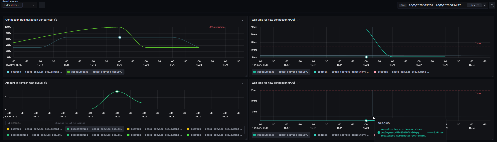

# Mongo.Connection.Telemetry

OpenTelemetry instrumentation and metrics for MongoDB connection pools in .NET.

## Overview

The standard MongoDB .NET Driver OpenTelemetry instrumentation only creates spans when a command is sent—after a connection has already been checked out of the pool. As a result, time spent waiting for a free connection in the connection pool (such as during pool exhaustion or peak loads) is invisible in traces and appears as an unexplained latency gap before the MongoDB command span starts.

`Mongo.Connection.Telemetry` closes this observability gap by providing:
- **Connection Checkout Spans**: Emits an OpenTelemetry span for any checkout that exceeds a configured wait-time threshold (`SlowCheckoutThresholdInMilliseconds`), as well as for every failed checkout (e.g. timeouts).
- **Connection Pool Metrics**: Tracks real-time connection usage, peak utilization, queue wait times, and maximum pool size via OpenTelemetry `Meter`.
- **Structured Warnings**: Emits warning logs when checkouts fail or wait for exhausted connection pools.

## Getting Started

### 1. Register OpenTelemetry Tracing and Metrics

Register the MongoDB connection activity source and meter with your OpenTelemetry builder:

```csharp
using Mongo.Connection.Telemetry;
using OpenTelemetry.Metrics;
using OpenTelemetry.Trace;

builder.Services.AddOpenTelemetry()
    .WithTracing(tracing =>
    {
        tracing.AddMongoConnectionTracing();
    })
    .WithMetrics(metrics =>
    {
        metrics.AddMongoConnectionMetrics();
    });
```

By default, `AddMongoConnectionMetrics` configures an `ExplicitBucketHistogramConfiguration` view for the meter with the following default bucket boundaries (in milliseconds):
`[0, 1, 2, 3, 4, 5, 6, 7, 8, 9, 10, 15, 20, 50, 100, 250, 500, 1000, 5000, 10_000]`.

You can optionally customize the bucket boundaries by passing a custom `ExplicitBucketHistogramConfiguration`:

```csharp
metrics.AddMongoConnectionMetrics(new ExplicitBucketHistogramConfiguration
{
    Boundaries = [0, 5, 10, 25, 50, 100, 250, 500, 1000, 2500, 5000]
});
```

### 2. Configure MongoDB Client Settings

Subscribe the connection pool telemetry when configuring your `MongoClientSettings`.

#### Basic Usage

```csharp
using MongoDB.Driver;
using Mongo.Connection.Telemetry;

var settings = MongoClientSettings.FromConnectionString("mongodb://localhost:27017");

settings.ClusterConfigurator = clusterBuilder =>
{
    clusterBuilder.SubscribeConnectionTracing("my-service-db");
};

var mongoClient = new MongoClient(settings);
```

#### Custom Options and Logger

You can customize tracing options inline or pass a custom logger factory:

```csharp
settings.ClusterConfigurator = clusterBuilder =>
{
    clusterBuilder.SubscribeConnectionTracing(
        "my-service-db",
        options =>
        {
            options.SlowCheckoutThresholdInMilliseconds = 25;
            options.IdleAfterNoRequestsInSeconds = 30;
        },
        loggerFactory);
};
```

#### With Dependency Injection

When registering a `MongoClient` with dependency injection, you can pass the injected `ILoggerFactory` and options:

```csharp
services.AddSingleton<IMongoClient>(sp =>
{
    var settings = MongoClientSettings.FromConnectionString("mongodb://localhost:27017");
    var loggerFactory = sp.GetService<ILoggerFactory>();
    var options = sp.GetRequiredService<IOptions<MongoConnectionTracingOptions>>().Value;

    settings.ClusterConfigurator = clusterBuilder =>
    {
        clusterBuilder.SubscribeConnectionTracing("my-service-db", options, loggerFactory);
    };

    return new MongoClient(settings);
});
```

## Configuration

Connection pool telemetry is configured using `MongoConnectionTracingOptions`. You can configure options via `appsettings.json` using the .NET Options pattern, or inline via code.

### Available Settings

- `Enabled` (*bool*, default: `true`): Enables or disables connection pool tracing and metrics.
- `SlowCheckoutThresholdInMilliseconds` (*int*, default: `15`): Threshold in milliseconds above which a connection checkout is considered slow and recorded as a span in the trace.
- `IdleAfterNoRequestsInSeconds` (*int*, default: `60`): Time in seconds without any checkout request after which an unused pool is reported as idle. Use `0` to report the pool as idle as soon as nothing is in use and nothing is waiting.

### Configuration via `appsettings.json`

Add the configuration section to your `appsettings.json`:

```json
{
  "MongoConnectionTelemetry": {
    "Enabled": true,
    "SlowCheckoutThresholdInMilliseconds": 10,
    "IdleAfterNoRequestsInSeconds": 60
  }
}
```

Register the options in your dependency injection container (`Program.cs`):

```csharp
builder.Services.Configure<MongoConnectionTracingOptions>(
    builder.Configuration.GetSection("MongoConnectionTelemetry"));
```

## Exported Telemetry

### Tracing
- **ActivitySource**: `Mongo.Connection.Telemetry`
- **Activity Name**: `MongoDb connection received from pool`
- **Tags**:
  - `db.client.connection.wait_time_ms`: Wait time in milliseconds.
  - `db.client.connection.count`: Number of connections in use.
  - `db.client.connection.max`: Maximum connection pool size.
  - `db.client.connection.checkout.failure_reason`: Reason for checkout failure (when failed).

### Metrics
- **Meter**: `Mongo.Connection.Telemetry`
- **Instruments**:
  - `db.client.connection.count` (*ObservableGauge*): Highest number of connections in use since the previous collection.
  - `db.client.connection.wait_queue` (*ObservableGauge*): Highest number of requests waiting for a connection since the previous collection.
  - `db.client.connection.max` (*ObservableUpDownCounter*): Maximum configured pool size.
  - `db.client.connection.wait_time` (*Histogram*): Time spent waiting to obtain a connection from the pool.
- **Tags** (on every measurement):
  - `db.client.connection.name`: Name identifying the client instance.
  - `db.server.connection.address` / `db.server.connection.port`: Server the pool connects to.
  - `db.client.connection.pool.idle`: `true` when no connection is in use, no request is waiting in the wait queue and no checkout request was received within `IdleAfterNoRequestsInSeconds`.
  - `db.client.connection.checkout.failure_reason`: Reason for checkout failure (wait time histogram, when failed).

#### Example metrics dashboards


## License

This project is licensed under the MIT License - see the [LICENSE](LICENSE) file for details.
